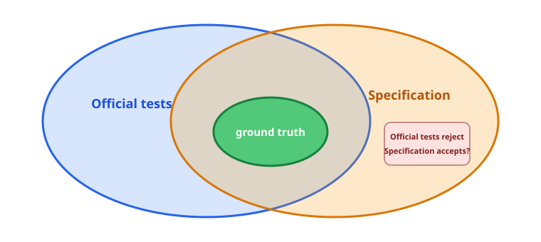

# Weekly Progress (2026-10-27)

## 1. Spec Testing

This week, we integrated the existing specification-testing tools into a unified workflow with three main components:

- **Completeness checking:** Check whether a specification sufficiently constrains an API's observable behavior and identify potential under-specification.
- **Equivalence checking:** Check whether two formulations of a specification accept exactly the same input-output pairs over the same calling domain, ensuring that a rewrite does not change the original semantics.
- **Test-case compatibility:** Convert existing test cases into compatibility checks for specifications. Specifically, we ask whether an input-output pair rejected by a test case can still satisfy the specification. If so, the specification is more permissive than the expected behavior expressed by the test and is therefore incompatible with it.

### Test-Case compatibility

Official tests, specifications, and the true semantics can be viewed as a region of input-output pairs. Ideally, the ground truth of the API intent is contained within both the region accepted by the official tests and the region accepted by the specification. However, both official tests and specifications are generally incomplete approximations of the ground truth.

**The question we care about is whether there exists an input-output pair that fails the official tests but is accepted by the specification.**



- If a pair is accepted by the specification but rejected by the official tests, it cannot belong to the ground truth. Such a witness therefore definitively indicates a problem in the specification; the converse does not hold.
- Test-case migration consequently provides **one-way error detection**: a specification behavior that fails the official tests is necessarily problematic, but passing all existing tests does not imply that the specification is correct or complete.

### Completeness Audit of Specifications Generated by Ruize

We used completeness checking to audit the specifications generated by Ruize for **Uluru** and **Base64**:

- **Uluru:** Of 29 specifications, 21 are complete, 4 are incomplete, and 4 are not applicable.
- **Base64:** 8 of the repository's 47 specifications are incomplete.

`decode_table` is a representative example of a partially constrained table. The function returns a `[u8; 256]`, but the generated specification requires only that the entries for the 64 valid alphabet symbols equal their corresponding sextet indices. It does not specify the values for the other 192 bytes. For the standard alphabet, byte index `0` is not an alphabet symbol, so both of the following results satisfy the current specification:

```text
result_1[0] = 255
result_2[0] = 0
```

As long as the two results agree at the 64 positions corresponding to alphabet symbols, both satisfy the specification, even though the complete 256-byte arrays are observably different. The `decode_table` specification is therefore incomplete. A repair should add a default/frame condition for every byte outside the alphabet—normally requiring `INVALID_VALUE`—or expose only an explicit semantic inverse-map view that captures the behavior relevant to the API.

## 2. Source Code Testing

We are pursuing source-code testing for two main reasons. 
1. Verification itself is expensive. If implementation bugs are encountered repeatedly during verification, we must interrupt the proof effort, locate and fix the source code, and then readjust the verification, substantially increasing the overall cost. We therefore want to use automated testing to find as many detectable bugs as possible before formal verification and reduce later rework.
2. source-code testing complements verification: formal verification normally depends on explicit specifications, preconditions, and trust boundaries, whereas fuzzing can directly explore boundary states that the executable implementation actually permits and reveal inconsistencies between verification assumptions and implementation behavior.

This week, we completed the integration of **OSS-Fuzz-Gen and OSS-Fuzz for Rust/Verus projects**, establishing a basic workflow from fuzz-target generation to continuous fuzzing.

More specifically, we built a controllable and convergent fuzzing pipeline for Rust/Verus projects on top of OSS-Fuzz-Gen:

1. **Deterministic API grounding:** Use tree-sitter to extract the crate's public APIs, type signatures, documentation, tests, unsafe code, and existing specifications while filtering out private implementation details. This prevents the LLM from using nonexistent APIs when generating harnesses.
2. **Scenario and oracle generation:** The LLM generates fuzz harnesses, test oracles, and testing scenarios from real APIs and historical-bug hints. Test sequences are not limited to a single method; they combine multiple operations through `Op` sequences to explore defects that arise only from stateful operation interleavings. Reference models are derived from API documentation and independent models rather than by copying the implementation under test.
3. **Smoke tests and repair:** Compilation errors, crashes found by short semantic smoke tests, hangs, and structural violations are fed back to the LLM for repair. This removes as many crashes caused by incorrect harnesses as possible before full fuzzing begins.
4. A key extension is **historical bug-pattern mining**:
   1. Extract code structures, input constraints, and invocation patterns associated with defects from the project's historical bugs and fixes.
   2. Abstract these historical bug patterns into reusable fuzzing templates, with an independent reviewer filtering unsupported patterns and LLM hallucinations.
   3. Use the templates to guide OSS-Fuzz-Gen toward more targeted fuzz targets and test inputs.
   4. Execute the generated targets with OSS-Fuzz and check whether they reproduce historical bugs or discover similar new defects.

This pipeline turns historical defect information into prior knowledge for fuzzing, focusing exploration on program paths that have been error-prone in the past rather than relying entirely on general-purpose input generation. The next step is to compare general fuzzing with history-guided fuzzing in terms of historical-bug reproduction, coverage, and new-bug discovery.

One important result is that **even though Ruize had fully verified this system, our fuzzing still found a real bug**. In [`servo/uluru#29`](https://github.com/servo/uluru/pull/29), `LRUCache::<T, 0>::new()` and `default()` successfully construct a cache because the constructor rules out only excessively large capacities and does not reject `N == 0`. Inserting the first element into this zero-capacity cache then attempts to evict from an empty array and immediately panics with an out-of-bounds error.

``` rust
use uluru::LRUCache;

fn main() {
    let mut cache = LRUCache::<u8, 0>::default();
    cache.insert(42); // panics
}
```

The verification missed this issue because it naturally introduced the following trust boundary:

```rust
pub open spec fn capacity_ok() -> bool {
    1 <= N < u16::MAX
}
```

## 3. Paper Writing

Shuvendu shared a highly related article, [Green proofs, empty promises: when AI agents write their own specifications](https://dev.to/malek_aitouaret_f026758c/green-proofs-empty-promises-when-ai-agents-write-their-own-specifications-59lf). It similarly checks in Dafny whether a postcondition permits two different outputs for the same valid input and then generates under-specification witnesses. Its core idea is almost identical to SpecDet's, so we would like to wrap up our current work.
The immediate paper-writing task is to double-confirm the **research questions**, including whether additional experiments are needed.

### Method

SpecDet focuses not on implementation correctness, but on whether a specification sufficiently determines an API's observable behavior. For the same input, SpecDet constructs a root determinism query that asks whether there can be two observably different outputs that both satisfy the current contract:

```text
requires(input)
&& ensures(input, output_1)
&& ensures(input, output_2)
==> equivalent(output_1, output_2)
```

If this property holds, the current specification is deterministic under the selected observation policy. If it does not, SpecDet generates a source-level divergence witness explaining how the two behaviors differ. We then validate these witnesses against the source code of real projects to determine whether they correspond to actual under-specification, and feed the resulting diagnoses back into specification generation to repair or improve generated specifications.

### Research Questions

1. **RQ1 — Decision Coverage**  
   To what extent can SpecDet produce conclusive spec-determinism decisions for real Verus specifications?

2. **RQ2 — Counterexample Generation**  
   For specifications whose root query has been confirmed nondeterministic, can SpecDet effectively generate credible and interpretable source-level divergence witnesses?

3. **RQ3 — Real-World Findings**  
   What source-confirmed under-specification does SpecDet find in real-world project corpora?

4. **RQ4 — Specification-Generation Utility**  
   Can SpecDet feedback improve Rust standard-library specification generation while preserving source consistency and determinism?
